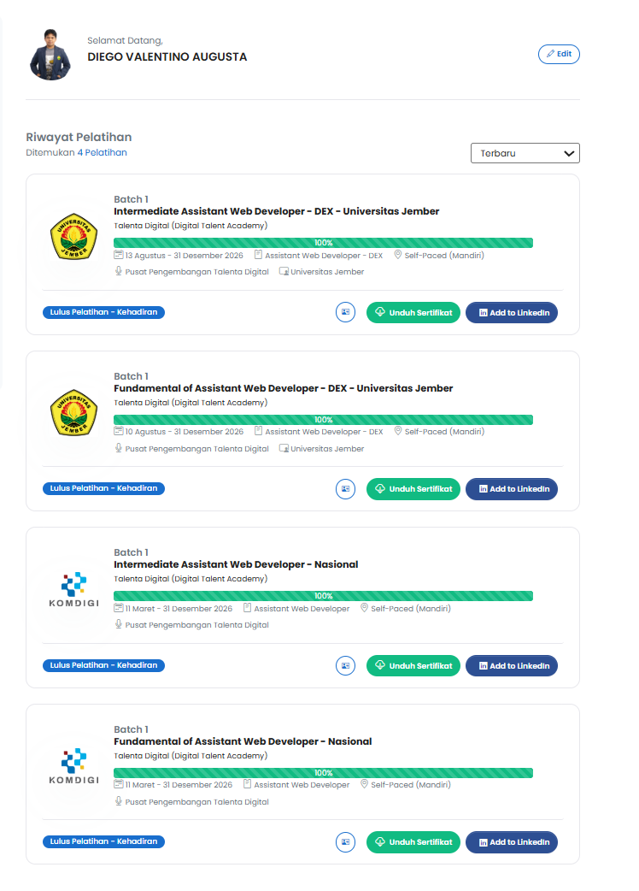

# Dokumentasi Pelatihan Digital Talent Komdigi 2026

Repository ini berisi dokumentasi dan bukti penyelesaian empat program pelatihan **Digital Talent Academy (DTA) – Digital Talent Scholarship 2026** yang diselenggarakan oleh Pusat Pengembangan Talenta Digital, Kementerian Komunikasi dan Digital (Komdigi).

Dokumentasi ini dibuat sebagai bukti pengerjaan **Quest Pemrograman Berbasis Web**, Program Studi Teknologi Informasi, Fakultas Ilmu Komputer, Universitas Jember.

## Informasi Peserta

- **Nama:** Diego Valentino Augusta
- **Program Studi:** Teknologi Informasi
- **Fakultas:** Ilmu Komputer
- **Universitas:** Universitas Jember
- **Program:** Digital Talent Academy – Digital Talent Scholarship 2026

## Daftar Pelatihan dan Sertifikat

Berikut empat pelatihan yang telah diselesaikan beserta sertifikat pendukungnya.

### 1. Fundamental of Assistant Web Developer – DEX – Universitas Jember

**Durasi:** 11,5 Jam Pelatihan

Materi yang dipelajari:
- Mengimplementasikan User Interface.
- Menerapkan perintah eksekusi bahasa pemrograman berbasis teks, grafik, dan multimedia.
- Menyusun fungsi, file, serta sumber daya pemrograman secara terorganisasi.

[📄 Lihat Sertifikat Fundamental DEX UNEJ](<01-Sertifikat_DIEGO VALENTINO AUGUSTA_Fundamental of Assistant Web Developer - DEX - Universitas Jember.pdf>)

### 2. Intermediate Assistant Web Developer – DEX – Universitas Jember

**Durasi:** 12,5 Jam Pelatihan

Materi yang dipelajari:
- Menulis kode sesuai guidelines dan best practices.
- Mengimplementasikan pemrograman terstruktur.
- Menggunakan library atau komponen yang sudah tersedia.

[📄 Lihat Sertifikat Intermediate DEX UNEJ](<02-Sertifikat_DIEGO VALENTINO AUGUSTA_Intermediate Assistant Web Developer - DEX - Universitas Jember.pdf>)

### 3. Fundamental of Assistant Web Developer – Nasional

**Durasi:** 11,5 Jam Pelatihan

Materi yang dipelajari:
- Mengimplementasikan User Interface.
- Menerapkan perintah eksekusi bahasa pemrograman berbasis teks, grafik, dan multimedia.
- Mengorganisasi fungsi, file, dan sumber daya pemrograman secara rapi.

[📄 Lihat Sertifikat Fundamental Nasional](<03-Sertifikat_DIEGO VALENTINO AUGUSTA_Fundamental of Assistant Web Developer - Nasional.pdf>)

### 4. Intermediate Assistant Web Developer – Nasional

**Durasi:** 12,5 Jam Pelatihan

Materi yang dipelajari:
- Menulis kode berdasarkan pedoman dan praktik terbaik.
- Mengimplementasikan konsep pemrograman terstruktur.
- Memanfaatkan library atau komponen yang telah tersedia.

[📄 Lihat Sertifikat Intermediate Nasional](<04-Sertifikat_DIEGO VALENTINO AUGUSTA_Intermediate Assistant Web Developer - Nasional.pdf>)

## Bukti Penyelesaian Pelatihan

Berikut merupakan tangkapan layar riwayat pelatihan pada platform Digital Talent yang memperlihatkan keempat program dengan progres penyelesaian **100%** dan status **Lulus Pelatihan – Kehadiran**.

## Penutup

Melalui keempat pelatihan ini, saya memperoleh tambahan pemahaman mengenai pengembangan antarmuka web, pemrograman terstruktur, penerapan praktik penulisan kode yang baik, serta pemanfaatan library dalam pengembangan aplikasi.

Repository ini disusun sebagai dokumentasi hasil pembelajaran sekaligus bukti pendukung penyelesaian Quest mata kuliah Pemrograman Berbasis Web, Fakultas Ilmu Komputer, Universitas Jember.

---

**Digital Talent Academy – Digital Talent Scholarship 2026**

**Diego Valentino Augusta**  
Teknologi Informasi – Universitas Jember
